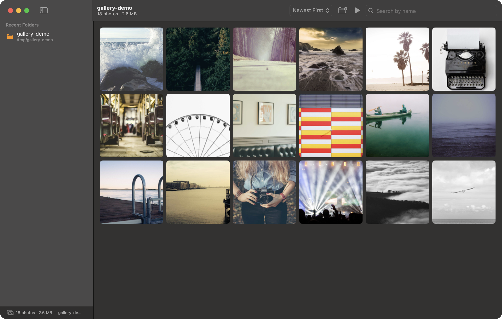
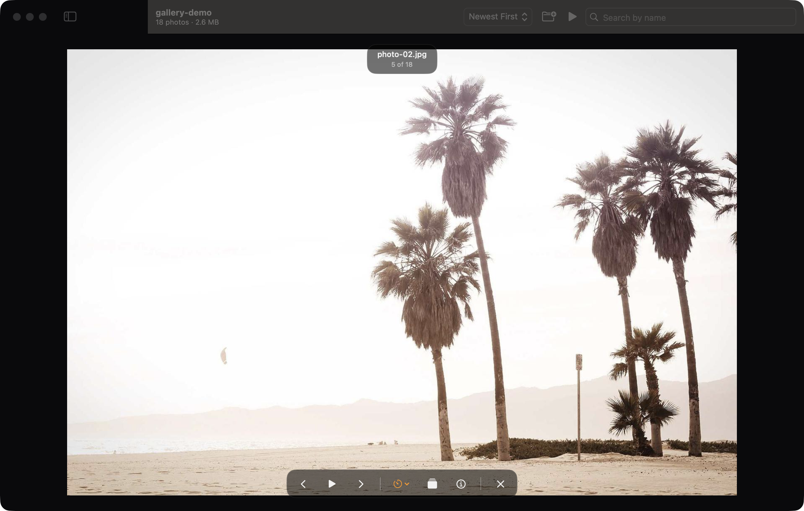
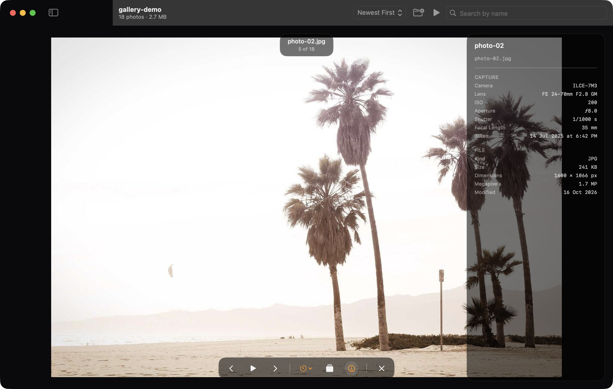

<div align="center">


# Gallery Cast

**A fast, native photo viewer for macOS with a built-in slideshow.**

[](#)
[](#)
[](LICENSE)
[](../../releases)

Browse any folder of photos in a clean, adaptive grid. Open a full-window
viewer with zoom, pan, and keyboard navigation. Play the folder as a
slideshow with crossfades and auto-hiding controls — or mirror it all to
a Cast device on your Wi-Fi. No import, no library, no setup.

<p align="center">
  <a href="../../releases/latest"><strong>Download Gallery Cast</strong></a>&nbsp;&nbsp;·&nbsp;&nbsp;
  <a href="#build-from-source">Build from Source</a>&nbsp;&nbsp;·&nbsp;&nbsp;
  <a href="#roadmap">Roadmap</a>
</p>



</div>

---

## Features

| | |
|---|---|
| **Folder browsing** | Point it at any folder — JPEG, PNG, HEIC, WebP, GIF, TIFF, BMP, AVIF. Recent folders stay in the sidebar. |
| **Clean grid** | Adaptive, retina-crisp thumbnails with hover previews and Finder-like natural sort. |
| **Full-window viewer** | Dark, distraction-free photo presentation with pinch-zoom, pan, and double-click zoom. |
| **Slideshow** | 2 / 5 / 10 / 15 second intervals, crossfade transitions, controls that fade away while playing. |
| **Cast** | Mirror the viewer to Cast devices on your Wi-Fi (Chromecast, Android TV) — the TV follows every photo you show. |
| **EXIF info panel** | Camera, lens, ISO, aperture, shutter, focal length, taken date, dimensions, file size. |
| **Search & sort** | Live filename search (case- and diacritic-insensitive), sort by name or date. |
| **Runs light** | Images decode off the main thread with a modification-aware cache; huge folders stay smooth. |

## Screenshots

| Viewer | Viewer + Info Panel |
|:---:|:---:|
|  |  |

## Installation

### Download (recommended)

Grab the latest **universal DMG** (Apple Silicon and Intel) from the
[releases page](../../releases), open it, and drag **Gallery Cast** into
**Applications**.

[](../../releases/latest)

### Build from source

Requires [Xcode](https://developer.apple.com/xcode/) (Swift 6.2+). Command
Line Tools alone are not sufficient on current SDKs — SwiftUI macro plugins
ship only with Xcode.

```bash
git clone https://github.com/mynameispathak/gallery-cast.git
cd gallery-cast
swift run
```

Or build an optimized, installable app bundle:

```bash
./scripts/build-app.sh release   # → GalleryCast.app
```

Run the test suite:

```bash
swift test
```

### Open a folder from the terminal

Gallery Cast accepts a folder path as its first launch argument, followed
by optional order-free flags (a photo index, `info`, `play`, and
`cast [name]`) — handy for shells and automations:

```bash
open GalleryCast.app --args ~/Pictures/vacation      # open a folder
open GalleryCast.app --args ~/Pictures/vacation 4    # …and jump to photo 4
open GalleryCast.app --args ~/Pictures/vacation play         # …and start a slideshow
open GalleryCast.app --args ~/Pictures/vacation 4 play info  # …with the info panel on
open GalleryCast.app --args ~/Pictures/vacation cast          # …and cast to the first device found
open GalleryCast.app --args ~/Pictures/vacation cast BRAVIA   # …and cast to a device matching "BRAVIA"
open GalleryCast.app --args ~/Pictures/vacation play cast BRAVIA  # flags combine, in any order
```

## Keyboard Shortcuts

| Key | Action |
|---|---|
| `⌘O` | Open a folder |
| `←` / `→` | Previous / next photo (viewer) |
| `Space` | Start / pause the slideshow |
| `⌘⇧P` | Play / pause the slideshow |
| `+` / `-` / `0` | Zoom in / out / reset |
| Double-click | Toggle 2.5× zoom |
| `I` | Toggle the info panel |
| `F` | Toggle full screen |
| `Esc` | Reset zoom, then close the viewer |

## Design

The UI is built on a small token system — spacing, radius, motion, and a
single amber accent — so the app stays consistent and native-feeling in both
light and dark mode. The viewer pins itself dark in both appearances so photos,
not chrome, dominate. Full details live in [DESIGN.md](DESIGN.md).

## Roadmap

- [x] Folder browsing, viewer, slideshow, EXIF panel
- [x] Universal binary (Apple Silicon + Intel) DMG releases
- [x] **Cast to Android TV / Chromecast** — devices discovered over Bonjour
      on your Wi-Fi; the viewer mirrors, photo by photo, via the CASTV2
      protocol and a local media server
- [ ] RAW format support (DNG, CR3, NEF…)
- [ ] Optional recursive folder scanning
- [ ] Slideshow transitions (Ken Burns, wipe)

## License

Gallery Cast is released under the [MIT License](LICENSE).
